  

  

  
  
  
  
  
  

---

## 👨‍💻 About me

I'm a full-stack developer at **CSK Infotech**, Greater Noida, with close to two years of shipping production systems. I like the part of software most people never see: the rules, permissions and background jobs that keep a business running correctly.

- 🏗️ I own the **quotation, approval and automation modules** of the CRM that runs the company's live sales pipeline
- 🛠️ I designed, built and deployed a **client IT helpdesk on my own**: 150+ faculty, a 10-person field team, **350+ tickets** resolved
- 🏆 Won the **"Choice of CSK"** award from the CEO (May 2026) for the CRM modules
- 📈 Joined as a trainee in April 2025, promoted to Software Engineer in October 2025
- 🎓 B.Tech in Computer Science, AKTU (2021 to 2025)

**What I'm good at:** access control · SLA design · audit logging · background jobs · login and SSO integration

---

## 🚀 Featured work

<table>
<tr>
<td width="50%" valign="top">

### 📊 Central CRM: quotation and approval engine
The enterprise B2B platform running the company's **live sales pipeline**.

   

- Compares prices from multiple vendors per item, with GST, freight and installation worked in
- Pending → Approved / Rejected flow; totals are recalculated on the server, never trusted from the browser
- Salespeople see only their own records, enforced in the database query, not just hidden in the UI
- A daily job flags deals stuck for 15+ days and sends each salesperson one summary email
- Connected to a central JWT / SSO login server; unknown roles get the lowest access by default

🏆 "Choice of CSK" award · 🔒 Internal company project, code is private

</td>
<td width="50%" valign="top">

### 🎫 Client IT helpdesk: built solo
Designed, built and deployed **alone** for an external client on a multi-year contract.

  

- Used by **150+ faculty** and a 10-person field team, with **350+ tickets** resolved so far
- Live SLA engine that works out deadlines in business hours, so they can't drift
- Escalation chain that checks every 5 minutes, with a full audit trail
- Access control for 4 roles
- Old MD5 passwords upgraded to bcrypt silently at login, with no forced reset

🔒 Client project, code is private

</td>
</tr>
<tr>
<td width="50%" valign="top">

### 🥤 Genzy Sip: scroll-driven product film
Scrolling plays a **540-frame film**, drawn frame by frame on a canvas. There's no video, so the motion stays locked to your scroll.

   

- Frames load in waves, so you can scroll through it within seconds
- If a frame isn't ready, the nearest loaded one is shown, so the canvas never goes blank

**[Live demo](https://genzysip.vercel.app)** · [Code]([GENZY_SIP_REPO_URL])

</td>
<td width="50%" valign="top">

### 🏥 SmartCare: AI healthcare portal
A hospital management portal that automates patient workflows.

   

- A generative-AI chatbot answers patient questions

**[Live demo](https://smart-care-frontend.vercel.app)** · [Code]([SMARTCARE_REPO_URL])

</td>
</tr>
</table>

---

## 🧭 Experience

| Role | Company | When |
|---|---|---|
| **Software Engineer** | CSK Infotech, Greater Noida | Oct 2025 – Present |
| Software Engineer Trainee | CSK Infotech, Greater Noida | Apr 2025 – Oct 2025 |
| Software Engineer Intern | Mangoesorange, Noida (hybrid) | Oct 2024 – Mar 2025 |

🏆 **"Choice of CSK"**, awarded by the CEO in May 2026 for the CRM modules that streamlined the sales team's daily work.

---

## 🧰 Tech I work with

<table>
<tr><td><b>Backend</b></td><td></td></tr>
<tr><td><b>Frontend</b></td><td></td></tr>
<tr><td><b>Databases</b></td><td> &nbsp; </td></tr>
<tr><td><b>Tools</b></td><td></td></tr>
<tr><td><b>Also</b></td><td>

</td></tr>
</table>

---

## 📈 On GitHub

  

  <picture>
    <source media="(prefers-color-scheme: dark)" srcset="https://raw.githubusercontent.com/Anurag945/Anurag945/output/github-snake-dark.svg" />
    <source media="(prefers-color-scheme: light)" srcset="https://raw.githubusercontent.com/Anurag945/Anurag945/output/github-snake.svg" />
    
  </picture>

---

## 🤝 Let's connect

  Hiring for backend or full-stack work, or need a system that has to stay correct? Let's talk.

  
  
  

  

